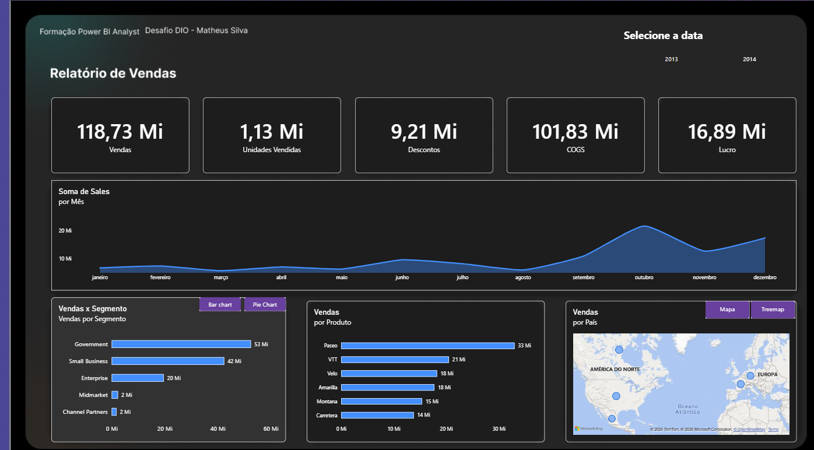
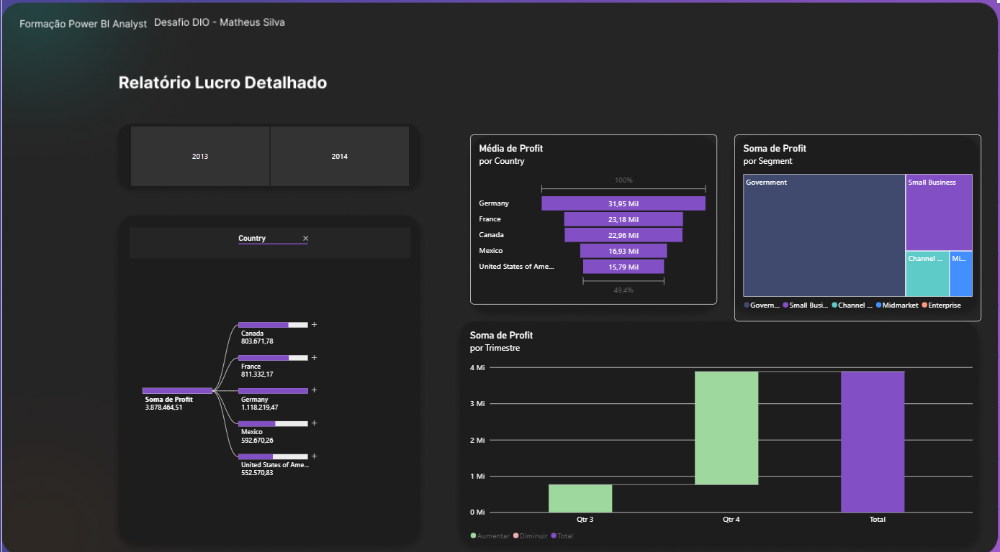

# Relátorio de Vendas e Lucro detalhado

## 📌 Sobre o projeto

Este projeto foi desenvolvido durante o curso Criando Um Relatório Gerencial de Vendas com Power BI, da plataforma DIO.
O objetivo foi desenvolver um relatório gerencial interativo utilizando o Power BI, aplicando conceitos de visualização de dados e Business Intelligence (BI) para transformar dados de vendas em informações relevantes para a análise do desempenho comercial.

## 🎯 Objetivos

- Desenvolver um relatório gerencial de vendas no Power BI;

- Explorar recursos de visualização e organização de dados;

- Apresentar indicadores de forma clara e intuitiva;

- Facilitar a interpretação dos resultados e apoiar a tomada de decisão baseada em dados;

## 🖥️ Visualização do relatório

Visão geral do dashboard

Na primeira tela temos uma visão geral do relatório de vendas onde temos uma visualização de Vendas por segmentos, Soma de vendas por periodo, além de segmentações por produto e país.

Na Segunda temos metas de lucros e análises comparando a soma de lucro por trimestre e por segmento.

## 🛠️ Ferramentas utilizadas

Power BI Desktop: criação do relatório e desenvolvimento das visualizações.

Business Intelligence (BI): organização e apresentação de informações para apoiar decisões de negócio.

Visualização de dados: representação gráfica de indicadores e resultados.

## 📚 Aprendizados

O desenvolvimento deste projeto contribuiu para a prática de conceitos relacionados à construção de relatórios gerenciais, à organização visual de indicadores e à comunicação de informações por meio de dashboards.

O projeto também reforçou a importância de transformar dados em informações compreensíveis, relevantes e úteis para o acompanhamento dos resultados de negócio.
